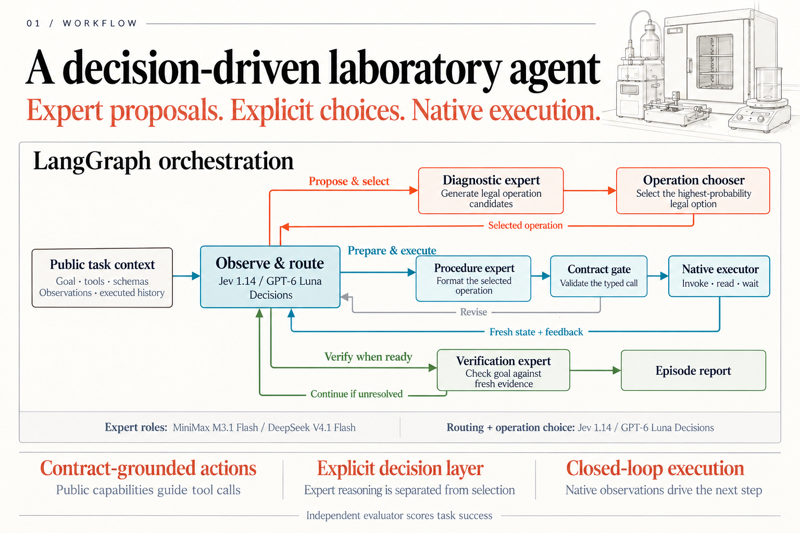
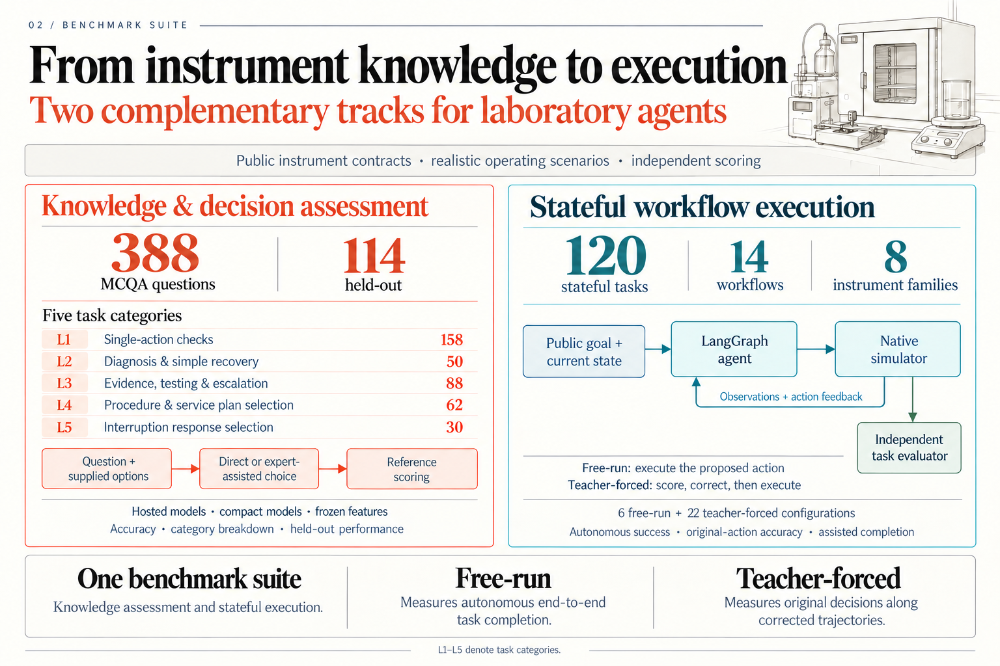

# OSI MatAgent

A decision-routed LangGraph workflow and an instrument benchmark: **388 multiple-choice questions** and **120 stateful tasks** across 14 workflow templates.



General experts propose actions; a decision model selects the route and operation. The shared graph validates each proposal and consumes native feedback before continuing. The evaluator owns simulation and scoring.



| Track | What it measures |
|---|---|
| MCQA | Selection among the original answer options |
| Free-run | Autonomous completion across an entire task trajectory |
| Teacher-forced | Original-action accuracy along reference-corrected trajectories, with assisted completion reported separately |

## Quick start

```bash
conda env create -f environment.yml
conda activate osi-hack
python benchmark/instrument/eval/validate.py
python -m pytest -q
```

The dataset, native runtime and graders are included. Model weights and credentials are supplied separately.

For hosted inference, set `OPENROUTER_API_KEY` in the environment:

```bash
python -m bench.instrument_eval_langgraph \
  --bundle benchmark/instrument --execution local-cpu \
  --mode free_run --all --continue-on-error \
  --expert-config configs/openrouter-minimax-m3.1-flash-low.json \
  --decision-model typesafe/jev-1.14 --expert-timeout 900 \
  --output results/my-free-run
```

Use `--mode teacher_forced` for corrected trajectories, or repeated `--case-id` arguments instead of `--all` for a subset. Calls use the exact configured model and may incur provider charges.

## Layout

| Path | Purpose |
|---|---|
| `app/` | Shared LangGraph and model/decision contracts |
| `bench/` | Hosted MCQA and sequential entry points |
| `benchmark/instrument/` | Frozen questions, native simulator and graders |
| `benchmark/graph/`, `benchmark/comparison/` | Local-model graph execution and comparison backends |
| `benchmark/evaluation/`, `benchmark/review/` | Result processing and browser review tools |
| `configs/`, `tests/`, `docs/` | Model settings, offline checks and documentation |

[Final report](docs/reports/instrument-evaluation-report.html) · [PDF](output/pdf/instrument-evaluation-report.pdf) · [Development](docs/development.md)

Raw traces, prediction files, logs, weights and intermediate analyses remain local under ignored output directories. Task questions, answer keys and evaluator fixtures are benchmark inputs; keep private keys and fixtures out of agent prompts. Attribution and data terms are included in [NOTICE](benchmark/instrument/NOTICE.md), [LICENSE](benchmark/instrument/LICENSE) and [asset terms](benchmark/instrument/LICENSE-ASSETS.md).
