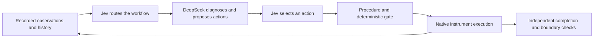

# Understanding the MatAgent demo

The demo replays a recorded LangGraph instrument-control run. The left panel shows
the workflow's requests, model responses, and instrument receipts. The center
renders the instrument from ChemLab Assets. The right panel shows the state at the
selected step. All three panels follow the same recorded timeline.

To open it, follow the [one-click replay guide](instrument-replay.md). No model
API key is required to view the included example.

## The experiment

The RC1mx + HFCal simulator begins with a fixed batch of **0.800 kg water and
0.020 kg acetic anhydride at 25 degrees C**. The built-in hydrolysis model converts
acetic anhydride and water to acetic acid. The goal is to warm the mixture to
**35 degrees C**, hold it within **34-36 degrees C**, and reach at least **99%
model conversion and stoichiometric product yield**.

Hydrolysis releases heat. If heat generation exceeds heat removal, temperature
can rise and accelerate the reaction, creating a thermal-runaway hazard in a real
experiment. Temperature control is therefore part of the task. This recording
demonstrates a bounded simulation with example kinetic priors, not validated
physical-laboratory performance.

The host supplies the initial charge and reaction model. The agent chooses the
instrument from the offered candidates and decides how to operate it: temperature
mode, target and ramp, stirring, recording, which public states to read, and how
long to wait. The task does not provide a sequence of operating commands.

## What each part of the workflow does

This branch's recorded example uses **DeepSeek** as the expert and **Jev** as the
decision model. Their responsibilities are separate:

| Component | Responsibility |
| --- | --- |
| Workflow / LangGraph | Maintain the task, observations, operation history, revisions and budgets |
| DeepSeek expert | Diagnose the available evidence, propose candidate actions, and prepare typed procedures or reports |
| Jev router and action chooser | Select the next expert route and choose among proposed operations |
| Deterministic gate | Validate the proposed command before execution |
| Native ChemLab runtime | Apply accepted operations and advance instrument state during waits |
| Independent evaluator | Check the task outcome and stopping boundaries using its own permitted evidence |

The main action cycle is shown below; routing can also request verification or a
report instead of another action.

An accepted command is an execution receipt, not proof that the experiment has
finished. The independent evaluator determines completion. The agent chooses when
to read sensors; a wait advances simulated time without automatically providing
fresh readings to the agent.

## Read the three panels

| Area | What it means | What to look for |
| --- | --- | --- |
| Left: Interaction | One saved workflow/model/instrument exchange | Direction label, Request/Response tabs, candidate parameters, chosen option and successful or rejected receipt |
| Center: Digital instrument | The ChemLab RC1mx + HFCal model animated from saved state | Stirrer movement, heating indication, simulation clock and displayed temperature |
| Right: Instrument state | Simulator ground truth alongside the agent's last actual readings | Temperature, observation age, control mode, RPM, recording state and evaluator-only conversion |
| Bottom: Playback controls | Navigation through the saved timeline | Previous/Next, Play, slider, All interactions or Action keyframes, and transition duration |

**Simulator ground truth** is internal simulation data from the independent
monitor. It was not necessarily available to the model. **Last readings available
to agent** are the observations actually returned to the workflow, with their
timestamps and evidence IDs. The values can differ because a sensor reading is
older or includes the simulator's measurement behavior.

Jev candidate cards show the choices it was offered. The Response tab marks its
recorded choice and any saved model-reported probabilities. These probabilities
are not demonstrated calibration or a guarantee of success.

## A short route through the example

1. Select **example-rc1mx-hydrolysis** in **Run record**. This sanitized sample is
   installed on first launch if `results/` contains no saved runs.
2. Keep **All interactions** selected to see the diagnostic requests and Jev's
   routing and action choices. Compare the Request and Response tabs.
3. Switch to **Action keyframes** to find the successful experiment-start,
   jacket-temperature and stirring operations. Proposed actions alone do not
   change the animated state.
4. Step through the heating and stirring receipts. The example uses a jacket
   temperature ramp toward 35 degrees C and a 400 rpm stirring command.
5. Advance through waits and readbacks. Watch the temperature approach the target
   while older agent readings retain their original timestamps. Long waits are
   compressed into short visual transitions.
6. Open **Recorded temperature trend** to see monitor samples up to the selected
   step. Future samples are not included in that step's trend.
7. Jump to the last step and inspect the final result. The included recording
   reaches the goal after **2,140 simulated seconds**, with approximately **35
   degrees C** reactor temperature and **99% model conversion**. These describe
   this one example, not aggregate benchmark performance.

## Heating, stirring, Tr and Tj

**Tj** controls the jacket temperature; **Tr** controls toward a reactor-temperature
target. The recorded example initially uses Tj. The agent is free to choose among
the permitted operations, rather than being given a required control mode.

The stirrer rotates continuously whenever the displayed RPM is above zero, even
when step playback is paused. This is visual motion; the simulation clock stays
at the selected step.

When actual heater-power data is unavailable, the scene labels its glow
**Estimated heating**. It compares the relevant saved temperature against the
last accepted target, using a 0.10 degree C display threshold. It does not report
measured heater power. The separate HFCal calibration rod follows its own saved
on/off state. Orange stirrer parts identify rotation, not heating.

## Why the run stops

The independent host monitor checks boundaries in two-second simulated intervals
and freezes the run at the first terminal condition:

- **Goal reached:** the public target predicates and at least 99% model conversion
  and product yield are satisfied, with no pending operation.
- **Instrument failure or rejected operation:** a native failure, capability,
  permission or scenario boundary ends this bounded run and preserves its logs.
- **Temperature outside the allowed band:** warm-up permits 24-36 degrees C.
  Once a sampled temperature first enters 34-36 degrees C, that holding band
  stays active; leaving it stops the run.

Execution budgets and model/transport errors can also stop a run. The final
record preserves the actual reason. Sampled temperature checks do not establish
a continuous-time guarantee, and model conversion is evaluator-only information,
not a calibrated HFCal measurement.

## Files, provenance and scope

The replay combines `result.json`, `manifest.json`, selection/execution traces,
and optional `monitor.jsonl`. It does not create new model responses or rerun the
chemistry. Missing readings remain unknown; failed commands do not update the
instrument state. Short transitions interpolate the display between recorded
states rather than reconstructing new physical measurements.

The 3D asset comes from **ChemLab Assets**, with a pinned revision and checksum.
Three.js renders it locally. See the [asset attribution](../../vendor/chemlab/NOTICE.md),
[asset license](../../vendor/chemlab/LICENSE-ASSETS.md), and
[sample provenance](../../examples/replay/README.md).

The RC1mx + HFCal instrument has a dedicated animated scene. Other saved histories
can retain their interaction/state views, but unsupported instruments are not
given a fabricated 3D reconstruction. Use **Original logs** to open the separate
history viewer and inspect the source events and result JSON.

For a new live-model run, use the [RC1mx workflow guide](rc1mx-hfcal-workflow.md).
That requires the full simulator environment and your own API credentials; the
portable replay needs neither.
