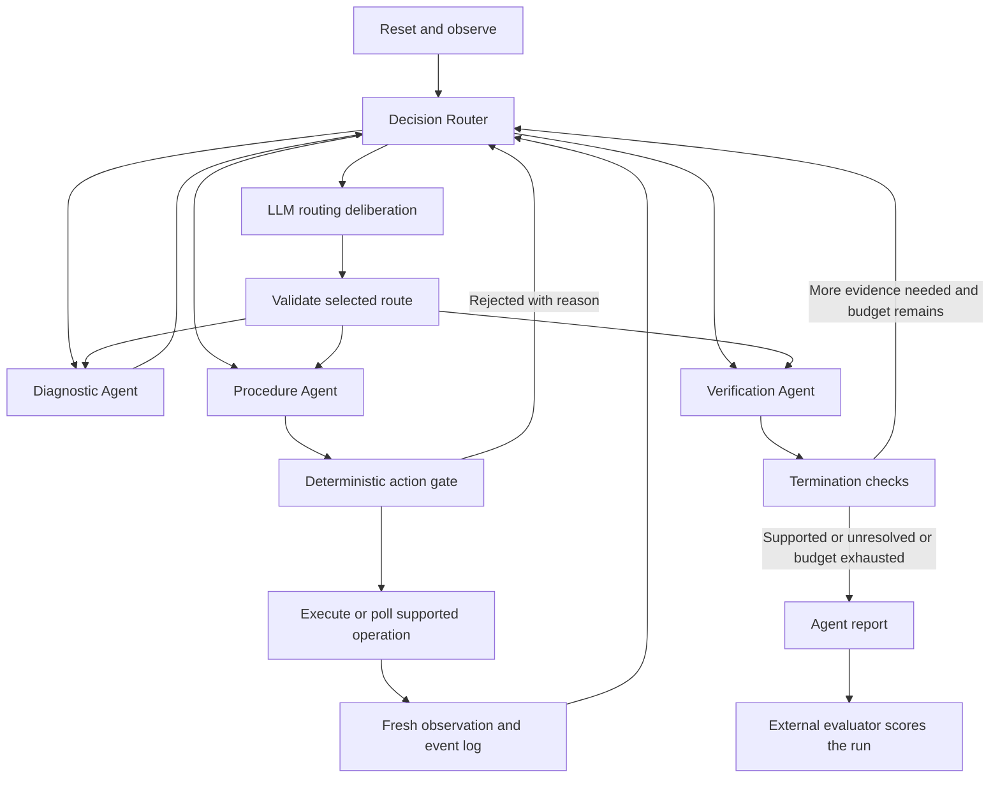

# Decision-Routed Multi-Agent Laboratory: A Two-Day LangGraph Demo and LLM Benchmark

**Revised 19 October 2026 · Proposal, implementation plan and evaluation protocol**

## 1. The two deliverables

Our hackathon has two equal priorities:

1. **Architecture:** build a multi-agent LangGraph system that operates a bounded ChemLab-Assets virtual environment, with a typed decision model such as OpenJev selecting routine routes and an LLM handling ambiguous planning.
2. **Evaluation:** run different LLM backends through the same architecture, measure task outcomes and operational cost, and explain failures using trace-level error categories.

The laboratory supplies consequential, inspectable actions and hidden evaluation state. Materials troubleshooting supplies tasks in which different evidence should lead to different actions. We will select the smallest scientifically meaningful case after inspecting the runtime; no particular compound is a prerequisite.

The proposed contribution is a **testable combination of decision-based coordination, specialized agents and failure attribution in a virtual materials lab**. Adding a decision model does not by itself prove research novelty or superiority. Our presentation will show what the design changes and whether measurements support its value.

By the deadline, deliver a live graph run, a compact reproducible benchmark table, an error heatmap, two annotated contrasting traces, and a source/configuration manifest. LangGraph, multiple agent roles, a real decision-model integration and at least two tested LLMs are core scope. Elaborate 3D, continuous chemistry and fine-tuning are optional.

## 2. Verified starting points and simulation ownership

The [official code repository](https://github.com/mbzuai-nlp/ChemLab-Assets) and [dataset](https://huggingface.co/datasets/MBZUAI/ChemLab-Assets) are the starting point. Download only selected assets and pin both revisions. Relevant runtime behavior still requires local execution; documentation inspection is not runtime validation.

The [upstream protocol](https://github.com/mbzuai-nlp/ChemLab-Assets/blob/main/skills/chemistry-lab-assets/references/protocol.md) was readable during this revision. Its `lab.*` surface is a logical adapter contract, not an automatically available SDK object. It distinguishes discovery, authorized reads, action invocation and supported asynchronous polling. Accepted operations are not necessarily complete; retries retain request identity. Actual bindings come from selected assets.

| Component | Plan and boundary |
|---|---|
| Native instrument behavior | Inspect contract, implementation and relevant tests; demonstrate a real state-changing action |
| Materials transition | Reuse only verified behavior; otherwise label a small authored state-transition table |
| Characterization/XRD | Reuse verified output or import labeled fixtures; a custom spectrum is not a native capability |
| Sample history | Maintain a small custom sample ledger and evidence references |
| Faults | Use verified native hooks or separately labeled scenario initialization |
| Evaluation truth | Remains outside every agent prompt, retrieval index and graph state |
| GLB/URDF | Optional visual context; geometry does not validate chemistry or robot manipulation |

Retain code/data provenance and respective licenses. Do not use a readout changing normally as evidence that a material reaction is simulated.

## 3. Architecture: three specialists and a decision-based coordinator

Use one explicit `StateGraph` with three role-specific LLM agents. Each has a distinct prompt, input projection and output schema. They may share one model backend; agent specialization does not require different model weights. Deterministic services handle execution and scoring. This keeps the multi-agent system inspectable and gives the benchmark clear points of failure.

| Component | Responsibility | Output / authority |
|---|---|---|
| Diagnostic Agent | Maintain competing causes; select a discriminating check or bounded correction using evidence | `HypothesisSet` and proposed intent; no direct environment writes |
| Procedure Agent | Translate an intent into a supported capability and valid arguments; inspect prerequisites | `ActionProposal`; may read capability descriptions, cannot bypass executor |
| Verification Agent | Check whether fresh observations support the requested outcome; challenge premature success | `VerificationReport`: supported, unresolved or contradicted; cannot set official score |
| Decision Router | Choose next specialist or escalation using a small typed option set | Route probabilities and selected route; no lab actions |
| Deliberation node | Resolve ambiguous routing or agent disagreement with a bounded LLM call | Same route schema; counted as an LLM call, not a fourth autonomous specialist |
| Tool executor + scheduler | Validate and execute accepted proposals; wait/poll; manage simulation clock | Observations, declared errors and operation status |
| Retrieval service | Return source passages using existing Materials Encoder when available | Cited evidence; no scenario answers |
| External evaluator | Score end state, evidence freshness and invariants | Official episode outcome; never callable by agents |

### Control flow



The diagram shows allowed paths; only one route fires at each coordinator step. Use sequential scheduling in the MVP. Parallel reads can be added later; never let two agents mutate the same instrument concurrently. Agents exchange typed records rather than unrestricted group chat. There is no requirement for a generic supervisor package: plain nodes, conditional edges and bounded loops are sufficient. See the companion reference guide, R4–R10.

### Shared state and handoff contracts

Keep these fields explicit: `episode_id`, `sample_id`, `observation_revision`, `observations`, `hypotheses`, `evidence_refs`, `intent`, `proposal`, `pending_operation`, `verification`, `route`, `action_count`, `llm_call_count`, `deadline`, and `terminal_reason`.

Every hypothesis records supporting and contradicting evidence IDs. Every intent records what observation would discriminate alternatives. Every action proposal includes the expected state revision, capability ID, arguments, request ID and intended postcondition. Every verification report cites a measurement newer than the last relevant action. A field with no observation is unknown, not zero or “normal.”

Single-owner mutable fields avoid conflicting updates. Append-only events carry unique IDs and are deduplicated; role-specific prompts receive only relevant observations and records. Facts from tools, retrieved claims and agent hypotheses remain distinguishable. No evaluator-only data belongs even in a graph “private” channel.

Use checkpoints with a unique thread ID for each episode/configuration/repeat. A graph checkpoint alone cannot restore an external simulator. For MVP, support full reset and deterministic replay; advertise mid-run resume only after both graph and world state can be restored consistently. Mutation requests need deduplication because node replay may otherwise repeat an action.

### Boundaries that must hold

- The router cannot skip hard prerequisites or authorize a lab mutation.
- Pending operations must be completed or resolved before interpreting their result.
- An LLM claim of success is scored separately from actual task completion.
- Read quality, sample identity and observation revision are preserved across handoffs.
- Terminal budgets are checked in code: proposed defaults are six lab actions, twelve LLM calls and a three-minute episode deadline. Graph steps are a separate limit.
- In a timeout after a possibly executed mutation, query the known operation or stop unresolved; do not repeat with a fresh request ID.

## 4. OpenJev integration: a measurable coordination layer

“OpenJev” is not a unique package. This proposal uses [ejhshen/OpenJev](https://github.com/ejhshen/OpenJev) with `shenjunhao/OpenJev-4B` as the **initial candidate**, subject to a hardware smoke test. Its README documents a local decision engine returning option probabilities. Another project, [razorback16/openjev](https://github.com/razorback16/openjev), is a different decision server. Their implementations and weight requirements must not be conflated. Laya remains an acceptable alternative decision backend; select one and record its exact identity.

Implement our own small `DecisionBackend.decide(state_summary, allowed_routes)` boundary. Try the selected model immediately on Day 1, not after the graph is finished. Do not start training or depend on obtaining access to a new hosted service during the event.

Router input: current stage, evidence freshness/quality, whether an intent or proposal exists, pending-operation state, verifier disagreement and budget remaining. Routes: `diagnose`, `prepare_action`, `verify`, `deliberate`. Filter invalid routes deterministically before the call. The summary template is fixed and logged; do not use an unaccounted LLM to produce it.

Illustrative request for the candidate backend; confirm against the pinned version:

```json
{
  "state": "Fresh scan conflicts with the proposed outcome. No operation is pending. Two causes remain unresolved.",
  "questions": {
    "route": {
      "type": "choice",
      "instructions": "Choose the next specialist based on the evidence available.",
      "criteria": {
        "diagnose": "Compare causes or select a discriminating check.",
        "prepare_action": "Translate an established intent into a supported action.",
        "verify": "Assess fresh evidence against the target outcome.",
        "deliberate": "Resolve conflicting or insufficient routing evidence."
      }
    }
  }
}
```

The adapter validates the returned choice and probabilities. Low confidence, a small top-two margin or an invalid response triggers bounded deliberation. Choose provisional cutoffs on development states and freeze them; probabilities are not proven calibrated for laboratory tasks. On inference failure, use a logged fallback route and count the failure. Benchmark runs with fallback must be flagged and must not silently count as successful decision-model integration.

Measure routing validity, unnecessary specialist calls, fallback frequency, routing latency and downstream outcomes. A small decision model can increase overhead or choose a harmful route; that is a result worth reporting. “Newer architecture” is not an acceptance metric.

## 5. Environment tasks: small enough to finish, rich enough to expose errors

Freeze one materials workflow by Day 1 hour 2. Prefer processing plus characterization, with at least one relevant native ChemLab action. Candidate question: **“Is the unexpected material result caused by the process, or by the measurement/sample preparation?”** The compound remains open until data and instrument checks are complete.

Build four task families, with two held-out variants each:

| Family | Required distinction | What success means |
|---|---|---|
| Process mismatch | Commanded conditions differ from adequate observed processing | Diagnose from a useful check, apply a bounded correction and verify new evidence |
| Measurement/sample-preparation issue | Observation is unreliable despite an acceptable process | Repair/repeat measurement rather than unnecessarily changing the material |
| Already acceptable | No intervention is warranted | Confirm from sufficient evidence and stop without unnecessary processing |
| Insufficient/conflicting evidence | Available observations cannot justify recovery | Identify what is missing and finish unresolved without false success |

Use four separate development episodes, one per family. The eight test cases must vary scenario parameters or evidence structure, not merely IDs. Keep the initial symptom ambiguous enough to require a check. Use a small deterministic fixture-based model where needed; label its assumptions. A wrong repair must not trigger a success fixture merely because it was attempted.

If XRD is selected, use a few curated reference patterns or CIF-derived synthetic patterns and multiple diagnostic features. Full diffraction fitting, phase-fraction calibration and reaction kinetics are outside the two-day core. A case with insufficient evidence should reward correct abstention, but report abstention separately from material recovery.

## 6. Benchmark design: separate model choice from architecture choice

### Experiment A — Which LLM works best in the fixed system?

Choose two accessible LLM backends at kickoff: one capable reference and one contrasting cost/size/family. Add a third only after the mandatory runs finish. Record exact provider model ID/version, date, generation settings, reasoning setting when applicable, context/token limits and transport adapter. Do not assume aliases or temperatures are equivalent across providers.

For each configuration, use the **same chosen LLM in all three specialist roles and the deliberation node**. Hold the decision backend, graph, prompts, tools, evaluator, scenario fixtures and retrieval corpus fixed. This measures whole-system behavior with a changed LLM backend. It does not isolate an individual role; optional role-swap tests are a separate experiment.

Mandatory matrix: **2 LLMs × 8 test cases × 2 repeats = 32 episodes**. Reset the world and graph per episode, reuse matched environment seeds, and interleave model order. Environment seeds do not guarantee identical stochastic model outputs. Do not cherry-pick the best repeat.

### Experiment B — Does decision-based routing help?

Keep the reference LLM fixed. Compare:

- `multi_agent + decision_router` — reuse its 16 episodes from Experiment A.
- `multi_agent + deterministic_router` — run the same 8 cases × 2 repeats: **16 additional episodes**.

Total mandatory end-to-end budget: **48 episodes**. The baseline uses the same specialist roles, tool access and terminal checks, with published fixed routing logic. This isolates the router change better than changing both model and graph at once.

Optional: single-agent baseline with the same tools, corpus and aggregate action/token budgets (16 additional episodes), then a third LLM. Without that baseline, do not claim multi-agent superiority over single-agent systems. An LLM-supervisor router is another later comparison, not a requirement.

### Fixed-observation diagnostic probe

Create 12 development and 12 held-out routing snapshots, balanced over the four routes. Annotate acceptable route sets where more than one next step is defensible. Compare router outputs on identical snapshots and a reordered-option copy. This helps distinguish routing mistakes from downstream trajectories that naturally diverge. The small probe supports debugging and coarse accuracy, not a strong calibration claim.

### Fairness, cost and stopping policy

Freeze prompts after development; run no test-driven prompt tuning without creating a new labeled result version. Keep the same observation content, retrieval corpus, retrieval limit and response schemas. Record any provider-specific wrapper or format differences. Either use common JSON output plus shared validation for all models, or label provider-native structured/tool output as part of the tested stack.

Count repair prompts and retries against the same limits. Include all specialist, deliberation, router and retrieval costs. Keep cold-start loading separate from warmed execution, and record hardware and inference concurrency. Cap concurrent episodes at two only if each has an isolated simulator instance; otherwise run sequentially. Pilot two episodes to estimate runtime and API spend before launching the matrix.

At a three-minute timeout, 48 episodes have a 144-minute sequential execution ceiling excluding resets, backoff and setup. Reserve a separate run window and cap transport backoff. If quotas prevent 48 runs, the minimum is 2 models × 8 cases × 1 repeat plus 8 baseline runs = **24 episodes**, explicitly reported as a single-repeat pilot. Preserve at least two LLMs and the router comparison before adding visuals.

Infrastructure failures remain visible: report attempted count, completed count, timeouts and provider failures. Publish success over all attempts and, secondarily, over valid executions; never silently remove bad runs.

## 7. Scoring and error analysis

Official task success comes from deterministic assertions over the evaluator's world state and event history. Require appropriate final condition, valid sample lineage, a post-action measurement where needed and no disallowed state mutation. Score diagnosis, recovery and evidence-supported stopping separately. The Verification Agent is part of the system being tested, not the benchmark judge.

| Metric | Definition |
|---|---|
| Task success | Fraction meeting family-specific evaluator criteria |
| Recovery rate | Fraction of recoverable fault cases restored and freshly verified |
| False success | Unsupported success declarations / all success declarations; also show raw counts |
| Appropriate abstention | Correct unresolved decisions on insufficient-evidence cases |
| Repeat consistency | Cases successful in both repeats / cases repeated; not best-of-two success |
| Action efficiency | Actions and specialist handoffs per case, including redundant/failed actions |
| Cost and latency | End-to-end time, tokens, actual estimated API charge and router overhead |
| Tool validity | Invalid schemas, unsupported capabilities and precondition violations |
| Routing behavior | Invalid routes, missed escalation, unnecessary escalation and fallback count |

Report per-family and overall counts; eight distinct cases are a pilot, not a broad model ranking. Repeats are not independent new tasks. If intervals are shown, resample paired case IDs rather than individual steps. Separate family-macro task success from recovery-only performance.

### Error taxonomy and attribution

The taxonomy below is our operational adaptation, informed by [MAST](https://arxiv.org/abs/2503.13657), not a verbatim reproduction of its labels.

| Code | Failure | Evidence to capture |
|---|---|---|
| E1 Observation | Ignores stale/missing data, wrong sample or incorrect units | Relevant observation ID and offending interpretation |
| E2 Domain reasoning | Unsupported material inference or ineffective corrective logic | Contradicting evidence and chosen hypothesis/action |
| E3 Planning | Repairs before checking, misses a prerequisite, repeats ineffective action | Decision sequence and expected discriminating check |
| E4 Tool use | Wrong capability/argument/schema or mistaken asynchronous completion | Request, response and operation status |
| E5 Coordination | Loses evidence in a handoff, violates role boundary, uses an obsolete proposal | Sender record, receiver input and revision |
| E6 Routing | Sends work to an unsuitable role or fails to escalate uncertainty | Router input, allowed choices, probabilities and subsequent effect |
| E7 Verification | Claims recovery without fresh evidence or persists after success | Verification report versus independent score |
| E8 Budget/termination | Loops, excessive handoffs or fails to stop unresolved | Counters and terminal reason |
| E9 Infrastructure/harness | Provider timeout, runtime defect, checkpoint/replay bug | Exception, environment/config and reproducibility check |

Assign a primary **first consequential error** and optional downstream labels. Record responsible component and whether the system recovered. Do not label every failed run “LLM reasoning.” Automatic labels handle schema/status violations; humans inspect semantic and coordination errors with model identity masked where practical. Two teammates independently review at least six failure traces and reconcile disagreements; if only one reviewer is available, state that limitation. An LLM judge may suggest labels but never defines ground truth or scores its own run alone.

An annotation record contains `run_id`, `step_id`, `component`, `error_code`, `evidence_ids`, `expected_behavior`, `observed_behavior`, `primary_or_downstream`, and `reviewer_status`. For a disputed cause, use “uncertain” rather than inventing precision. Optional counterfactual replay changes one routing decision at a saved observation and is labeled a diagnostic intervention, not a replacement benchmark result.

## 8. Two-day build plan

Assume two eight-hour working days. Suggested ownership is environment/tools, graph/decision integration, and benchmark/analysis if teammates are available; these are workstreams, not a request to create agents during proposal writing. A single builder follows the order below and uses the 24-episode fallback if required.

| Time | Small question and work | Exit condition / scope rule |
|---|---|---|
| Day 1, 0–1 h | Can one native example, the decision model and two LLM endpoints respond? | Save smoke-test outputs; choose accessible backends immediately |
| Day 1, 1–2 h | What minimal materials case fits verified capabilities? | Freeze scenario card, two distinguishable causes and ownership table |
| Day 1, 2–3.5 h | Can tools and evaluator run a scripted correct and wrong path? | Four development cases; wrong repair fails; hidden truth isolated |
| Day 1, 3.5–5.5 h | Can three specialists hand off typed records in LangGraph? | One complete model-driven run; JSON event trace |
| Day 1, 5.5–6.5 h | Does the actual decision backend select valid routes? | Router + escalation + deterministic baseline operate |
| Day 1, 6.5–7 h | Can the runner switch LLM configurations without changing tasks? | Two-model smoke comparison; estimated run cost/time |
| Day 1, 7–8 h | Resolve integration failures | End-to-end core works; cut UI/physics first |
| Day 2, 0–1 h | Freeze tests, prompts and manifests; wire small existing RAG corpus | Eight test cases + routing probe; benchmark launches |
| Day 2, 1–4 h | Execute matrix while building a minimal trace/results view | 48 runs targeted; monitor quotas without tuning on test results |
| Day 2, 4–5.5 h | What failed, where, and why? | Error labels, result table, two annotated failure/success traces |
| Day 2, 5.5–6 h | Freeze deliverables | Runnable demo, results, exact configs and run instructions |
| Day 2, 6–7 h | Contingency | Fix demo-breaking issues; label any rerun separately |
| Day 2, 7–8 h | Rehearse | Five-minute presentation and clearly labeled replay backup |

If the first OpenJev candidate cannot load, switch within the first hour to an available decision model, such as Laya, and record the change. A deterministic router can unblock graph development but does not fulfill the real decision-model deliverable. If no decision model or second LLM is available, explicitly mark the corresponding objective blocked; do not claim the core is complete.

Use existing Materials Encoder inference only if readily available. Fixed lexical retrieval is an acceptable documented fallback because model training/retrieval research is not the focus. Keep retrieval identical across tested configurations. LangGraph and specialist separation are no longer optional fallbacks.

## 9. Demo, artifact layout and acceptance

Five minutes: (1) show environment and graph; (2) run a task with visible specialist handoffs and router probabilities; (3) show an actual corrective action and independent verification; (4) compare model outcomes and error distributions; (5) inspect two traces where the first consequential error differs. Say whether a trace is live or replayed.

The UI needs a graph/timeline, current observation, evidence links and benchmark table. Reuse a GLB viewer if easy; prefer a correct trace display over custom robot animation. A useful heatmap has LLM configurations as rows and error categories as columns, with counts and denominators.

Suggested implementation structure:

```text
app/graph.py              # explicit nodes, routes and stop conditions
app/roles.py              # prompts and validated role records
app/decision_backend.py   # pinned OpenJev/Laya adapter
app/lab_adapter.py        # native/custom labels and action validation
app/scenarios.py          # resettable fixtures, sample state and clocks
bench/run.py              # configuration matrix and isolated resets
bench/score.py            # independent assertions
bench/annotate.py         # trace-based error records
configs/                 # frozen backend, prompt and budget manifests
cases/dev/ + cases/test/  # test truth never exposed to agents
results/                 # run JSONL, summary CSV, annotations and figures
```

Acceptance checklist:

- [ ] Three role-specific agents execute through a real LangGraph graph.
- [ ] One real decision-model backend routes work and has a measured baseline.
- [ ] A native ChemLab action changes relevant observable state.
- [ ] At least two LLM configurations complete the same test suite.
- [ ] Agent-visible records and hidden evaluator state are isolated.
- [ ] A wrong correction cannot pass; false success is counted.
- [ ] Errors are tied to concrete events and responsible components.
- [ ] Results include failed attempts, exact configurations and limitations.
- [ ] Restart instructions and replay artifacts work before presenting.

## 10. Reading and verification status

See [the implementation reference guide](../reference/implementation-guide.md) for an ordered reading path, exact official documentation, API integration notes and benchmark papers. Sources were consulted on 19 October 2026. This revision verified documentation and repository interfaces; it did not install packages, execute models, validate the selected laboratory asset or produce benchmark results. Select and pin the concrete instrument and model configurations in the first milestone.
