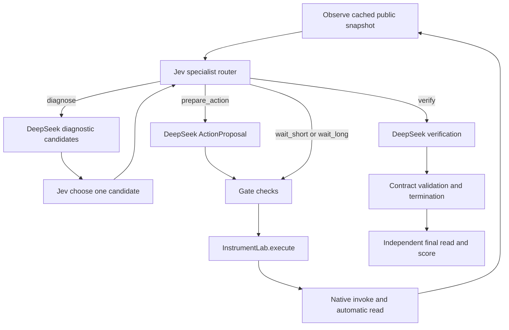

# Binder timer and furnace program demo for benchmark development

Recorded 21 October 2026. Both tasks ran through the same LangGraph using OpenRouter DeepSeek V4.1 Flash for general experts and hosted TypeSafe Jev 1.14 for specialist routing and operational selection. Both reached independent native goals and obtained supported reports citing fresh public evidence.

These are two concrete examples of contract-driven instrument control: a one-minute timer and an empty-furnace thermal program. They exercise parameter selection, prerequisites, command-versus-process completion, native time progression and evidence-grounded verification. Neither run synthesizes a material, manipulates a physical instrument or validates chemistry.

The report connects model decisions to Python adapter calls, native receipts and public state. Its accompanying JSON is an audit artifact for benchmark authors. The recorded action sequence is an observed solution and must never be included in a solver's task input.

## Results and count definitions

| Metric | Binder timer | Nabertherm furnace |
|---|---:|---:|
| Independent goal met | true | true |
| Expert supported and correct current evidence cited | true | true |
| Protocol correct and false success | true / false | true / false |
| Agent tool proposals executed | 5 | 13 |
| Workflow action counter including automatic readbacks | 9 | 25 |
| Native session invoke calls by the agent | 2 | 3 |
| Native public reads including initialization and independent evaluation | 7 | 15 |
| Native host step calls | 6 | 27 |
| Specialist router requests to Jev | 9 | 18 |
| Operational chooser requests to Jev | 3 | 4 |
| DeepSeek diagnostic requests | 3 | 4 |
| DeepSeek procedure requests | 3 | 4 |
| DeepSeek verification requests | 1 | 1 |
| Total model requests | 19 | 31 |
| Direct router waits | 2 | 9 |
| Native simulated time | 60 s | 270 s |
| Measured workflow wall time | 23.033 s | 27.897 s |
| DeepSeek tokens including prompt and completion | 83,363 | 33,015 |
| Hosted Jev tokens including input and structured output | 24,401 | 42,371 |
| Combined API tokens | 107,764 | 75,386 |

A tool proposal is one typed ActionProposal sent through gate and execute. workflow.inspect costs one workflow action; each native mutation or await costs two because the adapter automatically obtains a new public snapshot. Thus Binder is 1 + 4 × 2 = 9, and furnace is 1 + 12 × 2 = 25. Automatic readbacks do not require extra model tool proposals.

Native read counts add the constructor read and the independent final evaluator read: Binder 5 + 2 = 7, furnace 13 + 2 = 15. Host time advances in at-most-10-second chunks, so each 30-second await produces three native step calls. Neither run used poll/cancel, and neither had a pending asynchronous operation.

Wall time measures the workflow attempt as recorded by the runner; simulated time is controlled by host.step. Sleeping in real time or asking the verifier again does not advance native time. These meanings should remain separate in benchmark metrics.

## Task inputs and model roles

The task JSON provides a device ID, natural-language objective, public-state predicates, optional constraints/readable fields and simulation limits. Unknown fields are rejected. The single-instrument path does not accept reference_probe, steps or tool_menu and does not load generated reference action scripts.

The agent receives the complete implemented agent-visible native capability menu, not a preselected solution subset. Public discovery exposed 23 workflow/native capabilities and 22 readable slots for Binder, and 9 capabilities and 11 readable slots for the furnace. Metadata may contain native syntax examples and preconditions. Examples describe usage; they are not evidence or a task-specific reference sequence.

| Component | Actual interface and output | Responsibility |
|---|---|---|
| DeepSeek diagnostic expert | invoke(diagnostic, prompt, public payload, OperationOptions) | Propose 1–4 schema-valid candidate operations and short evidence-linked hypotheses |
| Jev operational chooser | choose(context, candidates) → OperationDecision | Select exactly one supplied candidate using returned probabilities |
| Jev specialist router | decide(summary, allowed_routes) → RouteDecision | Choose diagnosis, proposal preparation, bounded wait or verification |
| DeepSeek procedure expert | invoke(procedure, payload, ActionProposal) | Copy the selected intent into a typed proposal with scope/revision/request identity |
| Deterministic gate | check_operation_selection; lab.validate | Check authority, candidate identity, schemas, revision, replay and resource budgets |
| Native executor | InstrumentLab.execute; session.invoke/read; host.step | Perform authenticated public operations and record actual runtime state |
| DeepSeek verifier | invoke(verification, payload, VerificationReport) | Assess current public predicates, quality and freshness; cite the current observation |
| Independent evaluator | InstrumentLab.score(report) | Read again and calculate goal/protocol/claim outcomes independently of model wording |

DeepSeek endpoint: POST https://openrouter.ai/api/v1/chat/completions, model deepseek/deepseek-v4.1-flash, JSON-object output, temperature 0, stream false, max_tokens 6144, reasoning.enabled false. No empty/truncated response occurred in these two runs, no format repair was needed, and reported reasoning usage was zero.

Jev endpoint: POST https://openrouter.ai/api/alpha/decisions, requested model typesafe/jev-1.14, returned snapshot typesafe/jev-1.14-20261014. Each request asks one typed Choice question; native option probabilities are validated and retained. This hosted model differs from local OpenJev Flash 9B. Its probabilities are not established as calibrated on these instrument tasks.

## How a model selection becomes a native function call

### Ordinary operation path



The expert endpoint does not receive an OpenAI-style tools/tool_choice declaration in this runner. Experts return JSON matching OperationOptions or ActionProposal; trusted Python code later interprets the validated capability ID and arguments. Therefore model API requests, JSON action proposals and native Python calls are three separate layers of what is informally called a tool call. The capability contract is supplied as public context, so the model does not need built-in knowledge of every instrument or an arbitrary Python function name.

The procedure stage does not invent the next operation. Its proposal must match the chooser-selected capability and arguments. The gate checks both that selection and the current scope/revision, and the executor rechecks them immediately before invoking the runtime. Native preconditions are enforced by the runtime; the generic gate does not translate every native prose precondition into executable logic.

A capability such as nabertherm_l9::thermal.start_program is a namespaced string, not Python evaluated by the model. The trusted adapter strips the known namespace and calls the registered session:

```python
# Illustrative trusted mapping, matching the implementation.
native_name = proposal.capability_id.split("::", 1)[1]
response = session.invoke(
    instance_id=instance_id,
    capability_id=native_name,
    arguments=proposal.arguments,
    request_id=proposal.request_id,
)
```

The native runtime returns succeeded for command handling. A timer/program may still be running afterward. The adapter invalidates old evidence, obtains a fresh read, and returns to routing. Physical/simulated process completion must be established by later state, not by the successful command receipt.

### Direct wait path

When relevant public state shows an active process and goals remain unmet, Jev can choose wait_short or wait_long. Offered durations are at most 30/120 seconds and are capped by the task's per-wait and remaining simulation budget. These runs chose wait_short every time.

The graph constructs only workflow.await with the offered duration and records the actual routing decision and current revision as authorization. It passes through the same gate and executor; it does not call diagnostic, operation chooser or procedure just to wait. A mismatched, stale or fallback authorization cannot advance the clock.

```python
# Actual bridge behavior for these two runtime families.
left = 30.0
while left > 0:
    dt = min(10.0, left)
    host.step(dt)
    left -= dt
measurement = session.read(instance_id=instance_id, state_ids=public_state_ids)
```

There is no native session.invoke for workflow.await. host.step is a trusted simulator bridge, not a model-discovered host control or real-time sleep. For asynchronous supported families the adapter can additionally poll, but no such operation occurred here.

### Initialization and function inventory

InstrumentLab(task) resolves get_device and calls open_native(spec). The latter loads only registered module/class names, constructs the host, registers an agent principal, opens host.session(workflow), and calls session.describe(instance_id=...). InstrumentLab then reads its public field list once. The graph's observe node copies the cached snapshot; observe itself does not perform a new native read.

| Layer | Functions to inspect | Practical meaning |
|---|---|---|
| CLI | [app/instrument_cli.py:105](../../app/instrument_cli.py#L105) | Parse task/configuration; construct expert, router, chooser and shared ledger |
| Runner | [app/instrument_cli.py:25](../../app/instrument_cli.py#L25) | Save frozen manifest/contract; invoke graph; preserve failures and evaluate |
| Construction | [app/device_registry.py:17](../../app/device_registry.py#L17) | Trusted registry class loading, declared fixtures, agent session and describe |
| Routing | [app/graph.py:111](../../app/graph.py#L111) | Make genuine model route decision and authorize offered waits |
| Candidates | [app/graph.py:244](../../app/graph.py#L244) | Validate chosen candidate identity/probabilities and current world revision |
| Gate | [app/graph.py:328](../../app/graph.py#L328) | Check selected proposal, schema, scope and budget before execution |
| Native control | [app/single_instrument.py:314](../../app/single_instrument.py#L314) | Invoke native commands or bounded host steps and obtain new snapshots |
| Read receipt | [app/single_instrument.py:175](../../app/single_instrument.py#L175) | Check native identity, nondecreasing revision, clock and observation timestamps |
| Clock bridge | [app/single_instrument.py:112](../../app/single_instrument.py#L112) | Call the audited runtime host.step for these device families |
| Hosted decision | [app/openrouter_jev.py:52](../../app/openrouter_jev.py#L52) | Send typed Choice; validate actual model and probability distribution |
| Verification | [app/single_instrument.py:571](../../app/single_instrument.py#L571) | Validate model verdict against shared predicate and freshness semantics |
| Scoring | [app/single_instrument.py:389](../../app/single_instrument.py#L389) | Independent final public read; record goal, claim, citations and protocol |

Source links use repository-relative paths and GitHub line anchors. Per-run source hashes in the accompanying JSON identify the exact implementation used; line numbers alone are not immutable provenance.

## Binder timer trajectory

### Objective and initial conditions

The objective is to make a nonzero one-minute native oven timer expire. Success requires timer.state.expired=true and timer.state.set_s=60, both read from a fresh snapshot. timer.state is an object-valued native slot with unit 1; set_s is a nested member, so the predicate uses the slot unit 1 rather than inventing a seconds unit for the object.

Task inputs:

```json
{
  "task_id": "binder-timer-expiration",
  "device": "binder_fd056",
  "objective": "Make the oven's native timer expire after a nonzero one-minute interval. Use the instrument's public controls and verify the expired flag from a fresh read. Stop honestly if the runtime cannot support the task.",
  "predicates": [
    {
      "state_id": "timer.state",
      "path": [
        "expired"
      ],
      "operator": "eq",
      "value": true,
      "unit": "1",
      "absolute_tolerance": 1e-06
    },
    {
      "state_id": "timer.state",
      "path": [
        "set_s"
      ],
      "operator": "eq",
      "value": 60,
      "unit": "1",
      "absolute_tolerance": 1e-06
    }
  ],
  "constraints": [],
  "readable_state_ids": null,
  "max_simulated_seconds": 300.0,
  "max_wait_seconds": 120.0
}
```

The registered runtime is asset_runtime.binder_fd056.BinderFd056Runtime, with BinderFd056Session and native instance binder_fd056_01. The initial agent read shows power.on=false and an unset, non-running, non-expired timer.

Before agent execution, the trusted environment fixture issued plant.configure with ambient_k=295.15, pressure_pa=101325, mains_v=230 and noise_seed=1 using request_id=fixture-0. Its native receipt succeeded and native revision became 1. This setup is recorded in the manifest and is not counted as one of the two agent invokes. It is not exposed as an agent capability or a supplied timer solution.

### Every executed proposal and readback

The trace-event suffixes below locate records within this episode; the companion JSON retains full event IDs, proposal request IDs and all native receipts.

| Proposal | Trace event | Actual capability and exact arguments | Native time | Evidence | Public result |
|---:|---:|---|---:|---|---|
| 1 | 14 | `workflow.inspect` `{}` | 0 s | `obs-1` | power=false, running=false, expired=false, remaining=0 s, set=0 s |
| 2 | 27 | `binder_fd056::power.set` `{"on":true}` | 0 s | `obs-3` | power=true, running=false, expired=false, remaining=0 s, set=0 s |
| 3 | 40 | `binder_fd056::timer.set` `{"days":0,"hours":0,"minutes":1,"fan_after":"on"}` | 0 s | `obs-5` | power=true, running=true, expired=false, remaining=60 s, set=60 s |
| 4 | 46 | `workflow.await` `{"duration_s":30.0}` | 30 s | `obs-7` | power=true, running=true, expired=false, remaining=30 s, set=60 s |
| 5 | 52 | `workflow.await` `{"duration_s":30.0}` | 60 s | `obs-9` | power=true, running=false, expired=true, remaining=0 s, set=60 s |

No workflow.readback proposal appears in the model's selected sequence: readbacks after power, timer setup and waits are automatic adapter behavior. The timer remains non-expired after timer.set even though its native receipt succeeded.

### Parameter rules supplied by the runtime

power.set requires on as a boolean. timer.set requires days in 0–9, hours in 0–23, and minutes in 0–59; fan_after is optional and must be on/off if present. The agent supplied fan_after=on. Native preconditions require declared ambient environment and power outside standby. The offered pre-power timer candidate was schema-valid but not yet executable; operation selection chose power-on first. Schema validity does not imply native prerequisites hold.

### Actual native command calls

```python
session.invoke(
    instance_id='binder_fd056_01',
    capability_id='power.set',
    arguments={'on': True},
    request_id='a38f815d-943f-4ec7-a060-c47ef828ea39',
)
```

```python
session.invoke(
    instance_id='binder_fd056_01',
    capability_id='timer.set',
    arguments={'days': 0, 'hours': 0, 'minutes': 1, 'fan_after': 'on'},
    request_id='e2bb5abd-b990-4d43-9499-e43c26a57aa6',
)
```

For each call, session.read(instance_id=binder_fd056_01, state_ids=<22 recorded public state IDs>) follows automatically; the exact list is preserved in the evidence JSON. Both native command receipts had status succeeded and operation_id=null. Timer setup reported running=true, expired=false, remaining_s=60 and set_s=60.

The first wait calls host.step(10.0) three times, then session.read at time 30. The second does the same at time 60. Native revision stays 3 throughout both waits, while values and sample timestamps change. The workflow revision increases from 2 to 3 to 4 because time advancement invalidates previous evidence. This is a concrete reason benchmark evidence identity must include time/values/quality rather than native revision alone.

### What the operation chooser considered

Candidate IDs, argument values and probabilities are model outputs, not fixed task instructions.

| Decision | Offered candidates | Selected candidate | Selected probability |
|---|---|---|---:|
| Event 8 | `inspect_initial`: `workflow.inspect` `{}` | `inspect_initial` | 1.00 |
| Event 21 | `c1-power-on`: `binder_fd056::power.set` `{"on":true}`; `c2-readback`: `workflow.readback` `{}`; `c3-timer-set`: `binder_fd056::timer.set` `{"days":0,"hours":0,"minutes":1,"fan_after":"on"}`; `c4-stop`: `workflow.stop` `{"reason":"Timer expiry requires power-on and a 60 s host advance; verifying feasibility before committing."}` | `c1-power-on` | 0.98 |
| Event 34 | `c1`: `binder_fd056::timer.set` `{"days":0,"hours":0,"minutes":1,"fan_after":"on"}`; `c2`: `workflow.readback` `{}`; `c3`: `workflow.await` `{"duration_s":60.0}`; `c4`: `workflow.stop` `{"reason":"Timer expiration requires timer.set then await; if unsupported, stop honestly."}` | `c1` | 0.99 |

After power-on, the expert's short hypothesis text loosely described timer.set(0,1,0), which would be ambiguous/wrong if interpreted positionally. The selected candidate, procedure proposal and native invoke all used the exact named dictionary days=0, hours=0, minutes=1. Benchmark judgments should retain prose for analysis but score the validated arguments and observed state rather than treating an informal hypothesis as an executed call.

### Router decisions and completion evidence

| Route event | Chosen route | Returned probability | Meaning in this run |
|---:|---|---:|---|
| 4 | `diagnose` | 1.00 | Initial inspection planning |
| 10 | `prepare_action` | 0.98 | Prepare inspection proposal |
| 17 | `diagnose` | 1.00 | Power-on planning |
| 23 | `prepare_action` | 1.00 | Prepare power proposal |
| 30 | `diagnose` | 1.00 | Timer setup planning |
| 36 | `prepare_action` | 1.00 | Prepare timer proposal |
| 43 | `wait_short` | 0.58 | Advance timer to 30 seconds |
| 49 | `wait_short` | 0.96 | Advance timer to 60 seconds |
| 55 | `verify` | 0.97 | Verify expired state |

The final verifier received obs-9, workflow revision 4, capture step 9 after mutation step 8, native time 60, timer quality estimated, and the two public predicates. It returned:

```json
{"status":"supported","evidence_ids":["obs-9"],"missing_evidence":[]}
```

The role contract accepted estimated quality and the correct identity/freshness. The independent final read again found expired=true and set_s=60. Pending operation was null, protocol errors were empty and the cited evidence matched the current cached snapshot.

## Nabertherm furnace trajectory

### Objective and initial conditions

The objective is to run one segment at 323.15 K, ramp 0.1 K/s, and hold for at least 10 seconds. The evaluator also requires the configured segment to retain that target temperature and ramp rate. Success is native program execution, not a sample reaching a chemical phase.

Task inputs:

```json
{
  "task_id": "furnace-short-program",
  "device": "nabertherm_l9",
  "objective": "Run one native furnace program with a 323.15 K segment, a 0.1 K/s ramp and a 10-second hold. Establish completed program state and the full hold using fresh public observations. This is empty-furnace program execution, not material synthesis.",
  "predicates": [
    {
      "state_id": "program.phase",
      "path": [],
      "operator": "eq",
      "value": "completed",
      "unit": "1",
      "absolute_tolerance": 1e-06
    },
    {
      "state_id": "program.hold_elapsed_s",
      "path": [],
      "operator": "ge",
      "value": 10,
      "unit": "s",
      "absolute_tolerance": 1e-06
    },
    {
      "state_id": "program.segments",
      "path": [
        0,
        "temperature_K"
      ],
      "operator": "eq",
      "value": 323.15,
      "unit": "1",
      "absolute_tolerance": 1e-06
    },
    {
      "state_id": "program.segments",
      "path": [
        0,
        "ramp_rate_K_s"
      ],
      "operator": "eq",
      "value": 0.1,
      "unit": "1",
      "absolute_tolerance": 1e-06
    }
  ],
  "constraints": [],
  "readable_state_ids": null,
  "max_simulated_seconds": 1200.0,
  "max_wait_seconds": 600.0
}
```

The registered host is basic40_runtime_thermal.NaberthermL9Runtime with NaberthermL9Session and instance device-01. No extra fixture invocation occurred in this trajectory. The initial public read shows power disabled, no configured segment, running=false, phase=idle, hold_elapsed_s=0, door.closed=true, and indicated temperature/target 298.15 K.

The closed door is the runtime's initial state; the agent did not move it and the workflow did not fabricate a scene callback. Future benchmarks requiring a door-opening action must supply an actual supported scene adapter or accept an honest unsupported outcome.

### Preparation and start calls

| Proposal | Trace event | Exact capability and arguments | Snapshot | Phase and running | Why another decision is needed |
|---:|---:|---|---|---|---|
| 1 | 14 | `workflow.inspect` `{}` | `obs-1` | idle / false | Device is unpowered and program unset |
| 2 | 27 | `nabertherm_l9::power.set` `{"enabled":true}` | `obs-3` | idle / false | Power alone does not configure a program |
| 3 | 40 | `nabertherm_l9::thermal.configure_program` `{"segments":[{"temperature_K":323.15,"ramp_rate_K_s":0.1,"hold_s":10}]}` | `obs-5` | idle / false | Configured segment is still idle and must be started |
| 4 | 53 | `nabertherm_l9::thermal.start_program` `{}` | `obs-7` | ramp / true | Command accepted; ramp still needs native time |

```python
session.invoke(
    instance_id='device-01',
    capability_id='power.set',
    arguments={'enabled': True},
    request_id='4e96a62c-3317-4e91-99bf-34f9cca55bf4',
)
```

```python
session.invoke(
    instance_id='device-01',
    capability_id='thermal.configure_program',
    arguments={'segments': [{'temperature_K': 323.15, 'ramp_rate_K_s': 0.1, 'hold_s': 10}]},
    request_id='43b89f7c-62a8-453b-a7b8-47b43a9acd1b',
)
```

```python
session.invoke(
    instance_id='device-01',
    capability_id='thermal.start_program',
    arguments={},
    request_id='a3d8f45c-6d2b-4ade-aca2-9f68d988aa51',
)
```

Each successful command is followed by session.read(instance_id=device-01, state_ids=<11 recorded public IDs>). power.set returns enabled=true; configure_program returns segment_count=1; start_program returns running=true. Every receipt has operation_id=null. No asynchronous poll is involved.

The segment input schema permits 1–4 segments, temperature_K in 273.15–1373.15, ramp_rate_K_s in 0.001–1.0 and hold_s in 0–86400, with all three fields required. The start_program input schema is an empty object with no extra properties.

Native configure_program prerequisites include power enabled, no running program, and valid temperature/ramp/hold values. start_program additionally requires at least one segment and a closed door. These prerequisites come from the native capability contract, not a manually written furnace sequence.

At obs-5 after configuration, phase=idle and hold_elapsed_s=0. This is exactly the type of state where the earlier local-router run repeatedly called the verifier. In the successful run, Jev chose diagnose with probability 1.00. DeepSeek proposed start-program and readback-first; Jev selected start-program with probability 0.99, then selected prepare_action with probability 1.00. The normal procedure and gate produced the start call above.

### All nine wait calls and resulting state

Every row executes workflow.await(duration_s=30.0), realized as three host.step(10.0) calls and one public read. The router selected the duration from the offered short/long menu; no expert or operational-chooser request is made for these waits.

| Wait | Route event | Wait probability | Tool event | Time | Evidence | Phase | Target K | Indicated K | Hold s | Workflow revision / native revision |
|---:|---:|---:|---:|---:|---|---|---:|---:|---:|---|
| 1 | 56 | 0.73 | 59 | 30 s | `obs-9` | ramp | 301.15 | 301.15 | 0 | 4 / 6 |
| 2 | 62 | 0.58 | 65 | 60 s | `obs-11` | ramp | 304.15 | 304.15 | 0 | 5 / 9 |
| 3 | 68 | 0.59 | 71 | 90 s | `obs-13` | ramp | 307.15 | 307.15 | 0 | 6 / 12 |
| 4 | 74 | 0.53 | 77 | 120 s | `obs-15` | ramp | 310.15 | 310.15 | 0 | 7 / 15 |
| 5 | 80 | 0.67 | 83 | 150 s | `obs-17` | ramp | 313.15 | 313.15 | 0 | 8 / 18 |
| 6 | 86 | 0.68 | 89 | 180 s | `obs-19` | ramp | 316.15 | 316.15 | 0 | 9 / 21 |
| 7 | 92 | 0.69 | 95 | 210 s | `obs-21` | ramp | 319.15 | 319.15 | 0 | 10 / 24 |
| 8 | 98 | 0.73 | 101 | 240 s | `obs-23` | ramp | 322.15 | 322.15 | 0 | 11 / 27 |
| 9 | 104 | 0.75 | 107 | 270 s | `obs-25` | completed | 298.15 | 323.15 | 10 | 12 / 30 |

At 240 s the program is still ramping, with target and indicated temperature near 322.15 K and hold 0. At the next external snapshot, 270 s, phase=completed, running=false and hold_elapsed_s=10. The indication is 323.15 K, but the target has returned to the ambient 298.15 K as part of the native completion behavior. Requiring final thermal.target_k=323.15 would therefore be a wrong task oracle for this program. The task correctly checks the configured program.segments[0].temperature_K instead.

A simple ideal ramp estimate is (323.15 − 298.15) / 0.1 = 250 s, plus a 10 s hold, or about 260 s. The logged external observations establish completion by 270 s; they do not establish the exact internal transition time. Benchmark authors can use this reasoning to interpret the coarse sampling and possible over-waiting, but should not invent an observed completion at 260 s. Nine short waits are a successful policy, not evidence of optimal decision efficiency; longer waits could be evaluated under the same budgets.

### Candidate selection before each nonwait action

| Decision | Offered candidates | Selected | Selected probability |
|---|---|---|---:|
| Event 8 | `inspect-initial`: `workflow.inspect` `{}` | `inspect-initial` | 1.00 |
| Event 21 | `power-on`: `nabertherm_l9::power.set` `{"enabled":true}`; `configure-program`: `nabertherm_l9::thermal.configure_program` `{"segments":[{"temperature_K":323.15,"ramp_rate_K_s":0.1,"hold_s":10}]}`; `readback`: `workflow.readback` `{}` | `power-on` | 1.00 |
| Event 34 | `configure-program`: `nabertherm_l9::thermal.configure_program` `{"segments":[{"temperature_K":323.15,"ramp_rate_K_s":0.1,"hold_s":10}]}`; `readback-first`: `workflow.readback` `{}` | `configure-program` | 0.99 |
| Event 47 | `start-program`: `nabertherm_l9::thermal.start_program` `{}`; `readback-first`: `workflow.readback` `{}` | `start-program` | 0.99 |

### Final verification and independent score

The final router selected verify with probability 0.87. DeepSeek received obs-25 with workflow revision 12, capture step 25 after mutation step 24, native revision 30 and time 270. Native phase/hold/segments are estimated-quality observations accepted by the declared policy.

```json
{"status":"supported","evidence_ids":["obs-25"],"missing_evidence":[]}
```

The independent read checked:

| Predicate | Actual final value | Operator and expected value | Result |
|---|---|---|---|
| program.phase | completed | eq completed | met |
| program.hold_elapsed_s | 10 s | ge 10 s | met |
| program.segments[0].temperature_K | 323.15 | eq 323.15, absolute tolerance 1e-6 | met |
| program.segments[0].ramp_rate_K_s | 0.1 | eq 0.1, absolute tolerance 1e-6 | met |

The two nested program.segments predicates use native slot unit 1, while the native configure input parameters carry K and K/s. State-slot units and nested member/input units must not be conflated.

## Concrete proposal and API record shapes

### Action proposal handed to the gate

The following is the actual furnace start proposal, not a model-authored Python script:

```json
{
  "sample_id": "instrument:nabertherm_l9",
  "expected_revision": 2,
  "capability_id": "nabertherm_l9::thermal.start_program",
  "arguments": {},
  "request_id": "a3d8f45c-6d2b-4ade-aca2-9f68d988aa51",
  "postcondition": "Program running toward 323.15 K segment."
}
```

The expected_revision is the workflow revision, not the native state_revision. sample_id is the workflow instrument scope; instance_id belongs to the native session. request_id supports idempotent replay: an identical request returns the retained result, while reuse with different content is rejected.

### Hosted decision request and response

The adapter sends the following structure. state and criterion text below are abbreviated for readability; this is a structural illustration, not the exact full HTTP body. Exact bodies are in the local traces and the request fingerprints are indexed in the companion JSON.

```json
{
  "model": "typesafe/jev-1.14",
  "state": "<public routing prompt including task, goal checks, current readback, selected intent and offered options>",
  "questions": {
    "next_action": {
      "type": "choice",
      "instructions": "<choose among the supplied options>",
      "criteria": {"A": "<diagnose description>", "B": "<verify description>"}
    }
  }
}
```

Question options use canonical letters in the hosted call and map back to semantic route or candidate IDs. The adapter validates that every offered option is present, probabilities are finite, nonnegative and sum to one, and the selected choice is a maximum-probability option. Router errors stop the hosted episode rather than executing a substituted rules choice.

### Expert and observation boundaries

Diagnostic payloads contain the goal, current public observations, native contracts, prior hypotheses and actual errors. Operational-choice projections omit the repeated full manual and retain compact state, candidates and arguments. Procedure payloads contain the selected intent and only its relevant capability. Verification removes the full instrument contract and last-action payload, retaining public measurements, goal predicates and explicit quality policy.

An observation includes its workflow ID, scope, workflow revision, capture step, quality and the native envelope. The native envelope includes instance_id, state_revision, clock, and state values with units, quality and sample_time_s. Full snapshots for every step are embedded in the companion JSON. The independent final read itself is not persisted as a separate raw native event; its evaluated predicate outcomes and aggregate I/O counts are persisted in instrument_score. A benchmark release should consider retaining that final raw receipt too.

## Designing a benchmark from these examples

### Freeze the task and environment contract

The following are proposed benchmark requirements, not an already released dataset schema:

| Layer | Fields to freeze | Why these examples need it |
|---|---|---|
| Task identity | task ID, device/runtime revision, objective, public predicates, quality policy | Prevent silent changes to units, paths or success criteria |
| Environment setup | native constructor, fixture declaration/seed, initial public state, scene requirements | Binder uses an ambient fixture; furnace starts with door closed |
| Simulator progression | allowed clock adapter, maximum total/per-wait seconds | Neither inspection nor real wall time advances a process |
| Capability exposure | authenticated describe snapshot and public visibility filter | Candidate coverage depends on the actual implemented interface |
| Agent configuration | expert/router/chooser identities, exact snapshots, prompts, output ceiling, allowed fallback | Hosted Jev is a different model and moves decision usage into the API budget |
| Execution budgets | action count semantics, model calls, graph steps, episode deadline, shared API ledger | Automatic readbacks and direct waits have different costs |
| Evaluation | independent final read, cache freshness, constraint checks, supported claim/citation | Command receipt alone cannot prove timer/program completion |

For training/evaluation separation, store observed traces and any reference plans outside solver-visible task files. Distinct paraphrases of the same device/template are not independent scientific tasks. Split by device family, behavior or held-out parameter regime where that matches the evaluation objective, and version initial-state fixtures explicitly.

These two goal sets are intentionally small. Neither asserts a no-reset trajectory, continuous safety, chemical outcome or universally optimal plan. If a future task requires those properties, add public constraints and/or separate evaluator-side event predicates rather than pretending the current final-state predicates already check them. The evaluator currently has authored goals, not hidden scientific ground truth.

### Score separate dimensions

| Dimension | Recorded field or derivation | Interpretation |
|---|---|---|
| Goal satisfaction | score.goal_met / task_success | All final public predicates/constraints plus cache freshness and lifecycle conditions |
| Expert claim | report.status / score.agent_claim_supported | Whether the model claimed supported; this field is not an independent truth label |
| Citation correctness | score.evidence_cited | Current cached observation ID is cited |
| False success | score.false_success | Supported claim without met goal and current cited evidence |
| Protocol correctness | score.protocol_correct / protocol_errors | Known identity/clock/receipt handling errors; not physical safety or optimal planning |
| Lifecycle completion | pending_operation / lifecycle_resolved | Whether accepted asynchronous operations remain unresolved |
| Planning progress | repeated decisions with unchanged semantic evidence, invalid/misordered proposals | Diagnose liveness and prerequisite failures separately from provider failures |
| Acquisition effort | native read/invoke/step/poll/cancel counters | Distinguish observation gathering, controls and simulated dynamics |
| Model effort | router/chooser/role calls, repairs, prompt/completion tokens, provider cost | Include hosted decision usage and failed/empty requests |
| Time | wall latency and native simulated seconds | Different meanings; report both and control hardware/network/provider effects |

Constraints are empty in both tasks. The runtime checks constraints at observed states/await chunks when supplied; that is not a guarantee of continuous safety between integration steps. Correct protocol likewise does not prove chemical validity.

### Preserve a trace record for each layer

The companion single-instrument-demo-details.json contains two run records with task/limits, source and artifact hashes, fixture receipts, readable states/capability IDs, every tool proposal, request ID, native receipt, clock chunks, resulting snapshot, router decision, candidate selections, model request usage and final score.

Proposed benchmark trace fields should preserve at least:

```json
{
  "task_id": "<versioned task>",
  "episode_id": "<unique run>",
  "event_id": "<ordered event>",
  "parent_decision_event_id": "<router or chooser source>",
  "proposal": {
    "capability_id": "<namespaced capability>",
    "arguments": {},
    "sample_id": "<workflow scope>",
    "expected_revision": 0,
    "request_id": "<idempotency key>"
  },
  "native_receipt": {"instance_id": "<native instance>", "status": "succeeded"},
  "clock_steps": [{"dt_s": 10, "elapsed_s": 10}],
  "observation": {"id": "<evidence ID>", "native": "<full public envelope>"},
  "model_identity": "<requested and returned snapshot>",
  "usage": {"prompt_tokens": 0, "completion_tokens": 0, "total_tokens": 0},
  "failure_kind": null
}
```

This shape is a proposal. The current raw trace already retains most fields in separate ordered event types, rather than one combined event. Context and candidate rationales are public model outputs, not private reasoning. Never include credentials, evaluator-only fixtures, reference answers or private model reasoning in solver inputs.

### Development tests and controlled comparisons

Use the unchanged successful trajectories as fixtures for logger/evaluator regression, not as the solver's plan. Useful additional benchmark cases include power-off preconditions, stale proposals, malformed units/paths, missing clock support, unavailable scene requirements, failed/pending native operations, and valid versus estimated/unavailable readings.

Carry forward the observed earlier failures: repeated verification of one unchanged observation; repeated diagnosis of an existing intent; timer minutes=60 schema rejection; provider timeout/503; and empty length-truncated completions. Label environment unsupported, planning failure, protocol violation and provider failure separately. Count every attempted request, and never score a failed run's lower call count as improved efficiency.

For a causal comparison, hold goals, fixtures, candidate generation, verification policy, output ceiling, provider settings and budgets fixed. Change only the router or direct-wait policy. Candidate-generation quality and chooser quality can be evaluated separately by freezing candidate menus for targeted decisions; operational task success should still evaluate the full live workflow. Do not conflate the two settings.

Hosted Jev avoided the previous loop in these frozen runs, which predate the semantic duplicate-evidence guard. The subsequent [Astra code review](../evidence/single-instrument-code-review.md) reproduced and fixed duplicate verification and missing current-evidence citations. The current adapter persists semantic signatures containing task/constraints, scope, actual native values/units/quality/clock, pending state and freshness; observation IDs and revision counters alone do not reopen verification. Both fixes were validated offline, not by rerunning these demonstrations. The historical source hashes and results below remain unchanged.

## Reproduce and locate the evidence

From the canonical repository root, with the refreshed API environment and installed dependencies:

```bash
python -m app.instrument_cli \
  --task cases/instrument_tasks/binder-timer.json \
  --output results/new-binder-demo \
  --backend deepseek --router openrouter-jev --operation openrouter-jev \
  --max-output-tokens 6144 --actions 28 --model-calls 48 --seconds 360

python -m app.instrument_cli \
  --task cases/instrument_tasks/furnace-program.json \
  --output results/new-furnace-demo \
  --backend deepseek --router openrouter-jev --operation openrouter-jev \
  --max-output-tokens 6144 --actions 28 --model-calls 48 --seconds 360
```

These are live, billable reproduction commands, not offline replay. No new API request was made to author this report. Each run must use a new output directory and the existing durable shared 5M-token ledger; never reset the ledger to regain allowance. Network/provider behavior can change the returned trajectory.

Both runs used graph_steps=260, one bounded format/schema repair, a 90-second expert request timeout, 45-second Jev timeout and non-streaming expert requests. The CLI defaults for decision backends remain local OpenJev, so hosted flags must be explicit. A shell that predates a credential update may retain the old value; reload the shell environment without exposing key values.

| Artifact | Binder | Furnace |
|---|---|---|
| Raw events | [Binder trace.jsonl](../../results/hosted-jev-binder-v1/trace.jsonl) | [Furnace trace.jsonl](../../results/hosted-jev-furnace-v1/trace.jsonl) |
| Frozen source/task/configuration | [Binder manifest.json](../../results/hosted-jev-binder-v1/manifest.json) | [Furnace manifest.json](../../results/hosted-jev-furnace-v1/manifest.json) |
| Discovered native contract | [Binder public-contract.json](../../results/hosted-jev-binder-v1/public-contract.json) | [Furnace public-contract.json](../../results/hosted-jev-furnace-v1/public-contract.json) |
| Final report and evaluator outcomes | [Binder result.json](../../results/hosted-jev-binder-v1/result.json) | [Furnace result.json](../../results/hosted-jev-furnace-v1/result.json) |
| Effective expert configuration | [Binder expert-config.json](../../results/hosted-jev-binder-v1/expert-config.json) | [Furnace expert-config.json](../../results/hosted-jev-furnace-v1/expert-config.json) |

Raw trace links above are relative to this document and require the ignored results/ directory in a local checkout; those raw files are not published on GitHub. The accompanying compact JSON under docs/evidence is portable and preserves selected public evidence, exact argument dictionaries, model usage and artifact hashes. It does not contain the full large model prompt bodies; the local raw traces retain those.

The documentation extraction passed independent checks of all 18 executed proposals, all 33 native clock chunks, all 50 unique API reservations, 183,150 combined trajectory tokens, final action/read counters and eight recorded artifact hashes. No new model/API requests were made.

The implementation passed 165 regression tests in 80.80 seconds before these completed runs, and the 570 pinned native files matched their hashes. These existing checks validate interface and policy behavior; the report's offline extraction additionally reconciles model counts, token totals, executed schemas, clock chunks, evidence identities and artifact hashes.

See the [machine-readable detailed evidence](../evidence/single-instrument-demo-details.json), [prior hosted Jev comparison](../evidence/hosted-jev-validation.md), [single-instrument usage guide](../guides/single-instrument-agent.md), and [Astra failure analysis](astra-router-verification-review.md).
